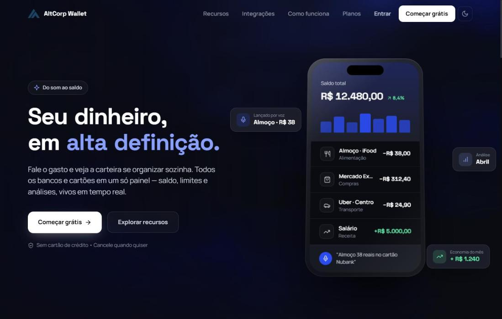

<div align="center">


<a href="https://github.com/Luizfmenezes">
  
</a>

<br/>

<a href="https://www.linkedin.com/in/luizfmenezes/"></a>
<a href="mailto:felipefonseca00@outlook.com"></a>
<a href="https://wallet.altcorphub.com/"></a>


</div>

---

## `> whoami`

```python
class LuizMenezes:
    role      = "Analista de Desenvolvimento de BI Pleno"
    location  = "São Paulo, BR 🇧🇷"
    company   = "Altcorp — automação, BI e web"

    stack = {
        "bi":         ["Power BI", "DAX", "Power Query", "Microsoft Fabric"],
        "data":       ["SQL", "Python", "pandas", "ETL", "PostgreSQL"],
        "dev":        ["TypeScript", "React", "FastAPI", "Docker"],
        "automation": ["RPA", "Bots WhatsApp/Telegram", "IA aplicada"],
    }

    building   = "AltCorp Wallet → wallet.altcorphub.com"
    proud_of   = "Dashboards de telemetria de frota que evitaram +R$ 50 mil em prejuízo 🚍"
```

---

## 🚀 Projeto em destaque — AltCorp Wallet

<div align="center">
  <a href="https://wallet.altcorphub.com/">
    
  </a>
</div>

<br/>

<table>
<tr>
<td width="50%" valign="top">

### O que é
SaaS de **gestão financeira pessoal**, em produção. Nasceu para aposentar minhas planilhas e virou produto.

- 📊 **Painel único:** saldo, cartões, faturas, despesas e metas
- 🎙️ **Lançamento por voz:** "almoço 38 reais no cartão"
- 🤖 **Bots com IA** no WhatsApp e no Telegram
- 🔔 Contas fixas automáticas, lembretes e score de saúde financeira

</td>
<td width="50%" valign="top">

### Stack


<br/><br/>

<a href="https://wallet.altcorphub.com/">
  
</a>

</td>
</tr>
</table>

---

## 🛠️ Tech Stack

<div align="center">

**Business Intelligence & Dados**


<br/><br/>

**Linguagens, Dev & Infra**


</div>

---

## 📂 Outros repositórios

<div align="center">
  <a href="https://github.com/Luizfmenezes/Altcorp-Insights"></a>
  <a href="https://github.com/Luizfmenezes/sptransmonitor"></a>
  <a href="https://github.com/Luizfmenezes/Automacoes-Pyhon"></a>
  <a href="https://github.com/Luizfmenezes/altcorp-avaria"></a>
</div>

---

## 📈 GitHub Stats

<div align="center">
  
  
  <br/>
  
  <br/>
  
</div>


